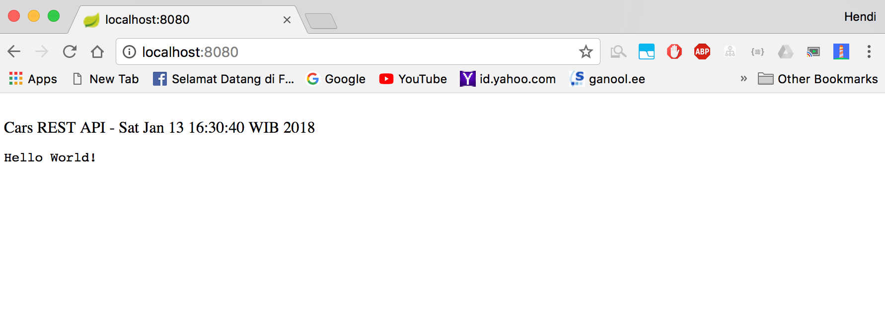
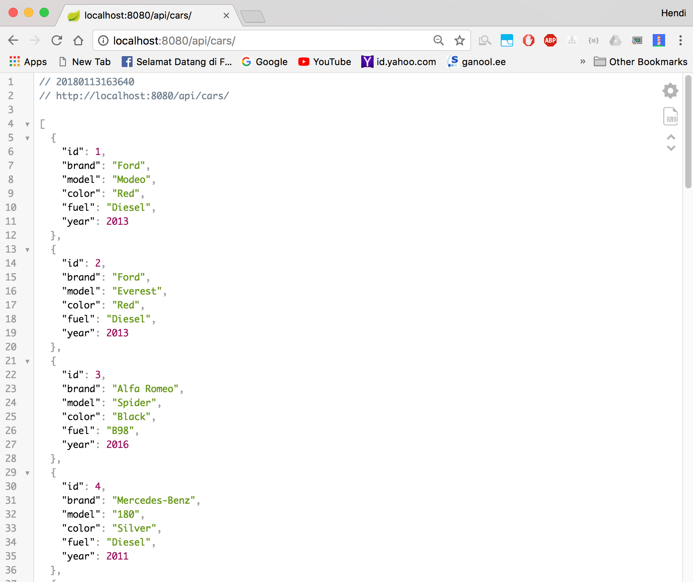
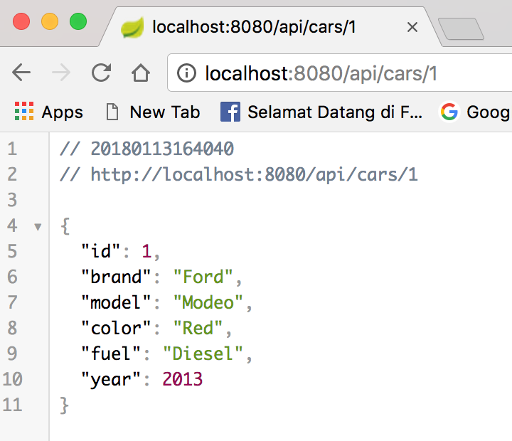
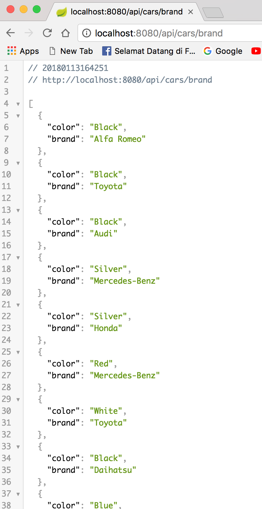

# Spring Boot Cars Rest Service

Simple REST API for Basic Learning

## Tech Stack

- Java 25 (JDK 25)
- Spring Boot 4.1.1 (Web, Data JPA, DevTools)
- H2 in-memory database
- Gradle 9.8.0 (via wrapper)

## Requirements

- JDK 25 installed. The Gradle toolchain is set to Java 25 in `build.gradle`.

Check your Java version:

```shell
java -version
```

On macOS with several JDKs installed, you can switch to JDK 25 for the current shell:

```shell
export JAVA_HOME=$(/usr/libexec/java_home -v 25)
```

## Build & Run

Build the project and run the tests:

```shell
./gradlew clean build
```

Run the application:

```shell
./gradlew bootRun
```

Or run the packaged jar:

```shell
java -jar build/libs/car-rest-service-0.0.1.jar
```

The application starts on `http://localhost:8080`.

## H2 Console

`http://localhost:8080/h2-console`

- JDBC URL: `jdbc:h2:mem:car`
- Username: `sa`
- Password: `sa`

## Endpoints

Home Page

`http://localhost:8080`



All Cars

`http://localhost:8080/api/cars`



Find Car by Id

`http://localhost:8080/api/cars/1`



Distinct Car by Brand & Color

`http://localhost:8080/api/cars/brand`


